# Architecture

gotuipic converts a raster image (PNG, JPEG, GIF, and optionally WebP/BMP/TIFF)
from a file, an `io.Reader` or an `image.Image` into colored UTF-8 text art for
terminals. It is a pure-Go library with no CGO. The core depends only on the
standard library.

- Module: `github.com/radix29/gotuipic`
- Status: design. `PLAN.md` gives the build order. This file describes the
  target shape, and each phase updates it as the code lands.

## Pipeline

Every conversion runs the same five stages. Each stage is a small, separately
tested unit, and only the public package knows about all of them.

```mermaid
flowchart LR
    A[file / io.Reader] -->|decode| B[image.Image]
    B -->|prepare: alpha composite,<br/>optional orientation| C[RGBA image]
    C -->|resize: area-average<br/>to cols·pw × rows·ph| D[pixel grid]
    D -->|render: Mode maps each<br/>pw×ph block to a Cell| E[Art: grid of Cells]
    E -->|quantize: ColorProfile| F[Art, palette colors]
    F -->|encode: ANSI / plain| G[io.Writer / string]
```



1. **Decode** (`decode.go`): `image.DecodeConfig` runs first, so dimensions
   above `MaxPixels` are rejected before any pixel memory is allocated (the
   decompression-bomb guard). It then calls `image.Decode`. Formats come from
   the standard `image` registry, so a caller adds a format by blank-importing
   its decoder.
2. **Prepare** (`internal/raster`): converts to `*image.NRGBA`, composites
   alpha over the `Background` color, and optionally applies the JPEG EXIF
   orientation (phase 5).
3. **Resize** (`internal/raster`): an area-averaging (box) downscale in linear
   light to exactly `cols·pw × rows·ph` pixels, where `pw×ph` is the current
   Mode's pixels per cell. This step uses no third-party resampler, so the
   output is deterministic and golden files stay stable across Go versions.
4. **Render** (`internal/glyph`): the selected Mode turns each `pw×ph` block
   into one `Cell{Rune, FG, BG}`.
5. **Quantize and encode** (`internal/palette`, `internal/ansi`): this stage
   maps colors to the target `ColorProfile`, then writes SGR escape sequences.

## Geometry

Terminal cells are about twice as tall as they are wide. `CellAspect` is the
cell's width divided by its height and defaults to `0.5`. Given a target width
in columns:

```
rows = round(cols × (imgH / imgW) × CellAspect)
```

The row count doesn't depend on the Mode. The Mode only changes how many
pixels are sampled per cell, so pixel aspect stays correct. `ModeASCII`
samples 1×2 pixels in a 1:2 cell, which gives square pixels; `ModeSextant`
samples 2×3, whose pixels are 4:3 tall - close enough. If the
caller gives both `Width` and `Height`, `Fit` decides whether the image is
contained (default), stretched, or cropped.

## Modes (pixels per cell → glyph)

Two modes ship, picked **at runtime** with `WithMode` (`-mode` in the CLI).
The default is `ModeSextant`. `tools/stylepreview` renders the three example
images in these two plus every variant that was measured, and `go run . -rmse`
prints sRGB-RMSE and Oklab-dE scores for each, so the choices below trace to
numbers.

| Mode | px/cell | Glyphs | Colors per cell |
|---|---|---|---|
| `ModeASCII` | 1×2 | ramp, default `" .:-=+*#%@"`, picked by luma ÷ coverage | FG = block average |
| `ModeSextant` (default) | 2×3 | U+1FB00–U+1FB3B, plus `▌▐█` and space | 2 (FG/BG) |

`ModeASCII` is the compatibility style: color text that needs no non-ASCII
glyph at all, so it survives any terminal, font, pipe or editor.
`ModeSextant` is the default: two colors in six subpixels are the most
detail an ordinary font renders per cell.

Every glyph is single-width, so column count equals rune count. That property
is an invariant, and a test checks it.

`ModeSextant` splits each block's six pixels into its two colors with an
**exact two-color partition**: all 63 non-trivial splits are tried and the
least total squared error against the two cluster means wins; a subset-sum DP
keeps each split's error O(1). The brighter mean becomes FG, and its
membership bitmask selects the glyph. 2-means (seeded by the darkest and
lightest pixels) stalls at local minima and is strictly worse, so the exact
partition is what ships.

The exact partition is also the measured limit of the 2×3 model: linear-light
split metrics, Floyd-Steinberg error diffusion across cells, and linear-light
resizing all scored worse on both RMSE and Oklab dE (`tools/stylepreview
-rmse`). More accuracy needs more subpixels per cell: Braille-dots-over-BG
(2×4) beats sextant by ~4% dE and U8GFX (2×8, U+30000–U+3144F) by ~10%, but
U8GFX needs a dense custom font (DotGothic-style coverage) and wide glyphs,
and the half/quadrant/Braille candidates fell between ASCII and sextant on
both quality and compatibility, so none of them ship as modes.

`ModeASCII` sets FG to the block mean color and picks the ramp glyph whose
light it can emit best: output luma ≈ FG luma × glyph coverage, and coverage
is taken as the glyph's ramp position (the classic ASCII-art assumption), so
index = targetLuma / fgLuma × (len-1). Mapping target luma straight to a ramp
position ignores the FG term and renders colored areas up to twice too dark;
the weighted pick roughly halves RMSE and Oklab dE on all three examples.
Floyd-Steinberg on the luma channel only matches the weighted pick (cell
luma quantization is already visible as texture, so there is little banding
left to diffuse), so ASCII stays a per-cell greedy pick.

The sextant mask needs a lookup table, not arithmetic. Unicode left out masks
0, 21, 42 and 63 because older blocks already cover them (space, `▌`, `▐`,
`█`), so code points after each gap shift down.

## Color

`ColorProfile`: `ColorNone`, `ColorANSI16`, `ColorANSI256`, `ColorTrueColor`.

- Nearest-color search runs in **Oklab**, with the palette precomputed once.
- The 256-color palette is the xterm table. The 6×6×6 cube uses levels
  `0,95,135,175,215,255` and the gray ramp is `8+10i`. The search tries both
  the cube and the gray ramp and keeps the closer match.
- The 16 ANSI colors vary between terminal themes, so the library uses the
  xterm defaults as an approximation and documents that.
- `Dither` (`DitherNone`, `DitherBayer4`) applies during palette
  quantization to break up banding; Bayer is position-stable, which suits
  animation. TrueColor never dithers. Error diffusion *between cells* was
  measured for both modes and scored worse, so there is no
  `DitherFloydSteinberg`.

## Public API (target)

```go
package gotuipic

func Convert(img image.Image, opts ...Option) (*Art, error)
func ConvertReader(r io.Reader, opts ...Option) (*Art, error)
func ConvertFile(path string, opts ...Option) (*Art, error)

type Art struct {
    Cols, Rows int
    Cells      []Cell // row-major, len == Cols*Rows
    // profile used by String/WriteTo
}
func (a *Art) At(col, row int) Cell
func (a *Art) String() string                       // ANSI, one line per row
func (a *Art) WriteTo(w io.Writer) (int64, error)  // io.WriterTo
func (a *Art) Plain() string                        // runes only, no escapes

type Cell struct {
    Rune   rune
    FG, BG color.RGBA // after quantization; A==0 means "terminal default"
}

// Options: WithWidth, WithHeight, WithFit, WithCellAspect, WithMode,
// WithColor, WithDither, WithRamp, WithInvert, WithBackground, WithMaxPixels.
```

Design rules:

- **The library never touches the environment.** It doesn't read `$TERM` or
  `$COLORTERM`, query the terminal size, or detect TTYs. The caller passes
  `Width` and `ColorProfile`. A helper `ProfileFromEnv(getenv func(string)
  string) ColorProfile` is available, but `Convert` never calls it. Only the
  CLI calls it.
- **`Art` is data, and ANSI is only one way to render it.** A tcell or other
  TUI program reads `Cells` and draws them, never parsing escape sequences.
  `examples/tcell` shows this. It is a separate module, so the library never
  depends on tcell.
- Options are validated in `Convert` and reported as a single error
  (`ErrInvalidOption` wrapped with details). Decode failures wrap
  `image.ErrFormat` or the underlying I/O error, so `errors.Is` works.
- No global mutable state: palettes and lookup tables are package-level
  values built at init or as literals.

## ANSI encoding (`internal/ansi`)

- The encoder emits SGR only when FG or BG changes from the previous cell, and
  writes `ESC[0m` at the end of every row so a resized terminal never bleeds
  color.
- Escape forms: truecolor uses `38;2;r;g;b` and `48;2;r;g;b`, 256-color uses
  `38;5;n` and `48;5;n`, and 16-color uses `30–37/90–97` and `40–47/100–107`.
- `ColorNone` output contains no `ESC` byte at all.
- Output is written through one `bufio.Writer`, with no per-cell allocations.

## Package map

| Path | Owns |
|---|---|
| `gotuipic` (root) | Public API, options, validation, `Art`, error values |
| `internal/raster` | Alpha compositing, orientation, linear-light box resize |
| `internal/glyph` | Modes: ASCII ramp, sextant table, exact 2-color partition, cell rendering |
| `internal/palette` | xterm 16/256 tables, Oklab conversion, nearest color, dithering |
| `internal/ansi` | SGR encoder |
| `formats` | Blank-imports `golang.org/x/image` WebP/BMP/TIFF decoders (opt-in) |
| `cmd/gotuipic` | CLI: flags, terminal size (`golang.org/x/term`), profile from env |
| `examples/*` | Runnable programs, including `examples/tcell` (separate module) |

Dependency direction: `cmd` and `examples` → root → `internal/*`. The
`internal/*` packages don't import each other, except that `glyph` uses
`palette` for luminance.

## Testing strategy

- **Synthetic inputs** are built in code (solid colors, gradients,
  checkerboards, a transparent-edge image). Committed fixtures in `testdata/`
  are kept small (a few KB) and are used for decoder coverage.
- **Golden files**: `testdata/golden/<case>.ans` holds the exact encoder
  output. `go test ./... -update` regenerates them. Review every diff.
- **Invariants for every mode and profile**: `Rows` lines, each with `Cols`
  runes after stripping ANSI; `ColorNone` output contains no `ESC`; each row
  ends in a reset.
- **Unit tests per stage**: a resized solid image stays solid, and a 2×2 block
  averages exactly; xterm table entries are exact; pure colors map to
  themselves; each sextant mask maps to its code point (table-driven over
  all 64 masks, checking the gap shifts at 21 and 42); the exact partition
  is never worse than 2-means on random blocks, and a solid block renders
  one color.
- **Fuzzing**: `FuzzConvertReader` must never panic or exceed `MaxPixels`.
- **Examples**: `example_test.go` uses `// Output:` with `ColorNone`, so the
  docs are compiled and checked.
- **Benchmarks**: a 4000×3000 image to 120 columns, for each mode.
